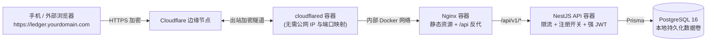

# Home Ledger 自托管部署与远程访问指南

本指南适用于将 **Home Ledger** 部署在家中电脑（Windows 本机或未来迁移到 Linux 迷你主机 / NAS），并通过 **Cloudflare Tunnel** 实现出门在外用手机、公司电脑浏览器直接访问。

> [!TIP]
> **为什么不需要购买腾讯/阿里云服务器？**
> 数据库与服务完全运行在家中设备本地硬盘上；出站由 `cloudflared` 容器主动建立加密隧道连向 Cloudflare 边缘节点。全程**无需家庭公网 IP、无需路由器端口映射、无需国内 ICP 备案、不暴露任何端口到公网**，且自动提供 HTTPS。

## 架构与流量拓扑



---

## 阶段 1：在本机一键跑起生产环境（本地验收）

1. **确保已安装并启动 Docker Desktop**（Windows 需开启 WSL 2 后端）。
2. **创建生产环境变量文件 `.env.prod`**（该文件已被 `.gitignore` 忽略，不会提交到 Git）：

   ```powershell
   Copy-Item .env.prod.example .env.prod
   ```

3. **生成强随机 `JWT_SECRET` 与数据库密码**（在 PowerShell 中执行）：

   ```powershell
   # 生成 48 位随机十六进制字符串，填入 .env.prod 的 JWT_SECRET
   -join ((1..48) | ForEach-Object { '{0:x}' -f (Get-Random -Max 16) })
   ```

   打开 `.env.prod`，重点修改以下两项：
   - `POSTGRES_PASSWORD`：替换为强密码（建议仅用字母和数字，避免特殊字符影响连接串）。
   - `JWT_SECRET`：填入上面生成的 48 位随机字符串（生产环境强制要求至少 32 位）。

4. **构建并启动全栈容器**（首次启动会自动运行 Prisma 数据库迁移与默认收支分类初始化）：

   ```powershell
   pnpm prod:up
   ```

5. **本地验收**：浏览器打开 `http://localhost:8080`，确认能够正常打开登录页并注册第一个家庭账号。

---

## 阶段 2：绑定域名与 Cloudflare Tunnel（实现出门访问）

### 2.1 准备域名

- 在 Cloudflare Registrar、阿里云、腾讯云或 Porkbun 等注册商购买一个任意便宜域名（年费约 ¥10–30，冷门后缀如 `.top` / `.xyz` / `.win` 即可），并将其 **DNS 托管到 Cloudflare**（免费套餐）。

### 2.2 创建 Tunnel 并获取 Token

1. 登录 [Cloudflare Zero Trust 控制台](https://one.dash.cloudflare.com/)（首次进入按引导选择免费版 Free Plan 即可）。
2. 左侧菜单进入 **Networks -> Tunnels**，点击 **Create a tunnel**，类型选择 **Cloudflared**。
3. 为隧道起个名字（例如 `home-ledger`），保存后在安装步骤页面复制 **Token**（即命令中 `--token` 后面的长字符串）。
4. 切换到 **Public Hostname** 标签页，点击 **Add a public hostname**：
   - **Subdomain**：例如 `ledger`
   - **Domain**：选择你的域名（如 `example.com`）
   - **Service Type**：`HTTP`
   - **URL**：`web:80`（注意：此处填 Docker 内部服务名 `web:80`，不要填 `localhost`）
5. 保存路由。

### 2.3 配置 `.env.prod` 并启动隧道

编辑 `.env.prod`：

```dotenv
CORS_ORIGIN=https://ledger.example.com,http://localhost:8080
CLOUDFLARE_TUNNEL_TOKEN=粘贴你的Tunnel_Token
```

然后启动包含隧道容器的完整服务栈：

```powershell
pnpm prod:tunnel
```

等待几秒后，用手机关闭 Wi-Fi（切到 4G/5G 流量）直接访问 `https://ledger.example.com` 即可使用。

---

## 阶段 3：锁定注册入口（家人注册完毕后必做）

为避免陌生人在公网访问你的域名后注册无关账号：

1. 先让你和家人全部完成账号注册，并通过「家庭邀请码」加入同一个家庭账本。
2. 编辑 `.env.prod`，将注册开关设为关闭：

   ```dotenv
   ALLOW_REGISTRATION=false
   ```

3. 重建/重启 `api` 容器使配置生效：

   ```powershell
   docker compose -f docker-compose.prod.yml --env-file .env.prod --profile tunnel up -d api
   ```

> [!NOTE]
> `ALLOW_REGISTRATION=false` 生效后，前端登录页会自动隐藏「注册新账号」标签，后端 `/api/v1/auth/register` 也会直接返回 `403 Forbidden`。同时登录与注册接口均内置了基于真实客户端 IP（优先识别 Cloudflare `CF-Connecting-IP`）的限流防爆破保护。

---

## 阶段 4：自动定时备份与异地容灾

项目中已内置双平台备份脚本，默认保留最近 30 天的 `.sql.gz` 压缩备份。

### 4.1 手动测试一次备份（并指向网盘同步目录）

建议将 `-BackupDir` 指向你的 **OneDrive / 百度网盘 / 坚果云** 本地同步目录，这样每次备份完会自动上传云端：

```powershell
# 示例：备份到 OneDrive 同步目录
.\scripts\backup-db.ps1 -BackupDir "$env:USERPROFILE\OneDrive\Backups\home-ledger"
```

### 4.2 配置 Windows 每天凌晨 3 点自动备份

在 PowerShell 中执行以下命令创建计划任务：

```powershell
$Action = New-ScheduledTaskAction `
  -Execute 'powershell.exe' `
  -Argument '-NoProfile -ExecutionPolicy Bypass -File "D:\WebstormProjects\home-ledger\scripts\backup-db.ps1" -BackupDir "D:\Backups\home-ledger"'
$Trigger = New-ScheduledTaskTrigger -Daily -At 3:00am
Register-ScheduledTask -TaskName 'HomeLedgerDailyBackup' -Action $Action -Trigger $Trigger -Description 'Home Ledger 每日自动备份数据库'
```

### 4.3 数据库恢复演练（验证备份可用）

如需从某个备份文件恢复数据（会覆盖当前数据库内容，请谨慎操作）：

```powershell
# 1. 解压备份文件为临时 SQL
$gz = Get-Item ".\backups\home-ledger-20261127-030000.sql.gz"
$in = [System.IO.File]::OpenRead($gz.FullName)
$gs = New-Object System.IO.Compression.GZipStream($in, [System.IO.Compression.CompressionMode]::Decompress)
$out = [System.IO.File]::Create(".\backups\restore.sql")
$gs.CopyTo($out); $out.Dispose(); $gs.Dispose(); $in.Dispose()

# 2. 导入到容器内 PostgreSQL（注意将 user/db 替换为 .env.prod 中配置的值）
Get-Content .\backups\restore.sql -Raw | docker exec -i home-ledger-prod-postgres psql -U home_ledger -d home_ledger
Remove-Item .\backups\restore.sql
```

Linux 下恢复只需一行命令：

```bash
gunzip -c ./backups/home-ledger-20261127-030000.sql.gz | docker exec -i home-ledger-prod-postgres psql -U home_ledger -d home_ledger
```

---

## 阶段 5：24 小时稳定挂机与未来迁移

### 5.1 旧笔记本 / Windows 挂机要点

- **合盖不休眠**：控制面板 -> 电源选项 -> 选择关闭盖子的功能 -> 接通电源时设为「不采取任何操作」，并关闭自动睡眠。
- **开机自动拉起**：在 Docker Desktop 设置中勾选 **Start Docker Desktop when you sign in to your computer**；配合所有容器已配置的 `restart: unless-stopped`，重启后会自动恢复服务。
- **防止系统半夜自动重启**：Windows 更新设置中配置「暂停更新」或调整使用时段，并设置 Windows 自动登录（`netplwiz`）以便断电重启后免密进桌面拉起 Docker。

### 5.2 未来迁移到 Linux 迷你主机 / NAS

整套服务完全容器化，未来购入 N100 小盒子或 NAS 后，只需 4 步无缝迁移：

1. 在新机器安装 Docker 与 Docker Compose，将项目代码与 `.env.prod` 拷贝过去。
2. 从旧机器执行一次 `backup-db.ps1` 拿到最新 `.sql.gz` 备份。
3. 在新机器运行 `docker compose -f docker-compose.prod.yml --env-file .env.prod --profile tunnel up -d --build` 拉起服务。
4. 用上述恢复命令把 `.sql.gz` 导入新机器的 `postgres` 容器，Cloudflare Tunnel Token 无需修改即可直接接管域名流量。

### 5.3 Linux 定时备份（`crontab`）

未来迁至 Linux 后，可使用仓库自带的 `scripts/backup-db.sh`：

```bash
chmod +x scripts/backup-db.sh
# 每天凌晨 3 点备份
(crontab -l 2>/dev/null; echo "0 3 * * * /path/to/home-ledger/scripts/backup-db.sh >> /var/log/home-ledger-backup.log 2>&1") | crontab -
```

---

## 附：如果未来觉得 Cloudflare Tunnel 慢，如何切到国内云服务器？

如果你后续想购买腾讯/阿里云轻量服务器（需个人 ICP 备案）追求国内毫秒级延迟，**家里电脑上的 Docker 应用架构零改动**：

1. 在云服务器上部署 `frps`（服务端），放行 `443` 端口并配置 Nginx/Caddy 自动签发 HTTPS 证书反代到 FRP 映射端口。
2. 在家里电脑上注释掉 `docker-compose.prod.yml` 中的 `cloudflared`（或不使用 `--profile tunnel`），运行 `frpc` 客户端将本地 `127.0.0.1:8080` 映射到云服务器即可。
